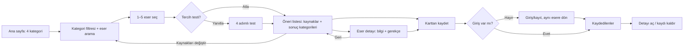

> **Arşiv notu (30 Ekim 2026):** Bu çoklu kaynak ve kategoriler arası öneri taslağı mevcut MVP akışını göstermez. Güncel uygulama tek eser seçer, aynı kategoriden önerir ve 500 özgün temsili SVG kullanır. [Durum raporu](mvp1-durum-raporu.md).

# Öneri Atlası — ilk teslim

**Akış ve ekran taslakları.** Kararlar: Dört kategori (kitap, film, dizi, oyun), farklı kategorilerden 1–5 başlangıç eseri, kategoriler arası öneri, hesaplı kaydetme ve gerçek görseller. Arama şimdilik eser adına göre.

## İlk sürüm kararları

1. **Arama:** Yalnızca eser adına göre çalışır. Tür adına veya özelliğe göre arama bu sürümün kapsamında değildir.
2. **Kaydetme:** Hesap gerekir. Misafir kullanıcı öneri görebilir; eser kaydetmek istediğinde giriş veya kayıt ekranına gider ve işlem tamamlanınca eser kaydedilir.
3. **Görsel yön:** Örnek site belirlenmedi. İlk sürümde mevcut açık zemin, mor vurgu, DM Sans gövde yazısı, Playfair başlıklar ve orta yoğunluklu düzen kullanılır. Bu seçim değiştirilebilir.
4. **Taslak paylaşımı:** Bu Markdown dosyası GitHub dalında paylaşılır; ayrıca kâğıt çizimi veya Figma dosyası hazırlanmaz.
## Tek sayfalık kullanıcı akışı



Boş aramada sorguyu temizleme veya kategori değiştirme; boş öneride başka sonuç kategorisi veya kaynak eser deneme; hatada yeniden deneme gösterilir. Geri dönüşte seçimler korunur.

## Düşük ayrıntılı ekranlar

### 1. Ana sayfa / kategori

**Telefon**
```text
Öneri Atlası                 Kaydedilenler
Sevdiğin eserlerden yenilerini keşfet
[ Eser seç ]
Kategori seç
[Kitap] [Film]
[Dizi]  [Oyun]

Giriş / kayıt
```

**Masaüstü**
```text
Öneri Atlası             Kaydedilenler  Giriş
Sevdiğin eserlerden yenilerini keşfet
[ Eser seç ]
[Kitap] [Film] [Dizi] [Oyun]
```

Kategori kartı aramayı ilgili filtreyle açar. Ana eylem “Eser seç”tir.

### 2. Eser arama ve seçimi

**Telefon**
```text
← Ana sayfa                  1/3
Sevdiğin eserleri seç
[ Eser adına göre ara ________ ]
[Tümü] [Kitap] [Film] [Dizi] [Oyun]
Seçilenler (2/5): Eser A ×  Eser B ×
[kapak] Eser C · Film · türler [Seç]
[kapak] Eser D · Film · türler [Seç]
[Önerilere geç] [Tercih testi]
```

**Masaüstü:** Sol bölümde kategori filtresi, seçilenler ve devam eylemleri; sağ bölümde geniş arama ve iki sütunlu eser sonuçları. Kategori filtresi gerçekten çalışır. Seçilen eserler filtre değişince korunur; beş sınırı açıklanır.

### 3. Öneri listesi

**Telefon**
```text
← Seçime dön              Kaydedilenler
Başlangıç eserlerin: Eser A · Film; Eser B · Kitap
[Kaynakları değiştir]
Sonuç kategorisi: [Kitap] [Film] [Dizi] [Oyun]
[gerçek görsel]
Öneri E · Film · Dram, Macera
Kısa açıklama...
Neden? Ortak tema ve atmosfer.
[Detay] [Kaydet]
```

**Masaüstü:** Üstte kaynak eserler, altında dört sonuç kategorisi sekmesi; en çok üç kart sütunu. Her kartta gerçek görsel, başlık, türler, kısa açıklama, gerçek eşleşmeye dayanan gerekçe ve kaydetme bulunur. Sonuç kategorisi kaynak eserin kategorisiyle sınırlı değildir.

### 4. Eser detayı

**Telefon:** Geri bağlantısı → büyük gerçek görsel → başlık, kategori, yıl, türler → açıklama → “Neden önerildi?” → Kaydet.

**Masaüstü:** Gerçek görsel solda; aynı bilgiler ve kaydetme eylemi sağda. Giriş yoksa kaydetme giriş/kayıta götürür ve aynı detaya döner. Kaydedildiyse “Kaydı kaldır” görünür.

### 5. Kaydedilenler

**Telefon:** Başlık → tek sütunlu kartlar (görsel, başlık, kategori, Detay, Kaydı kaldır).

**Masaüstü:** Ana gezinmede ayrı “Kaydedilenler” bağlantısı; iki veya üç sütunlu kart ızgarası. Kaldırma sonrası liste hemen güncellenir.

## Durum matrisi

| Ekran | Yüklenme | Boş sonuç | Hata |
| --- | --- | --- | --- |
| Ana sayfa | Katalog bekleniyorsa durum metni | Uygulanmaz | Katalog açılamadı + Yeniden dene |
| Arama | Seçilenler kalır, sonuç iskeleti | “Bu kategoride eşleşme yok” + aramayı temizle / kategori değiştir | Eserler alınamadı + Yeniden dene; seçim korunur |
| Öneriler | Kaynaklar kalır, kart iskeleti | “Bu kategoride öneri yok” + başka kategori / kaynak değiştir | Öneriler alınamadı + Yeniden dene |
| Detay | Geri bağlantısı ve bilgi iskeleti | Uygulanmaz | Detay veya kayıt hatası + Yeniden dene |
| Kaydedilenler | Başlık ve kart iskeleti | “Henüz eser kaydetmedin” + Öneri al | Liste/kaldırma hatası + Yeniden dene |

## Erişilebilirlik

Arama alanında görünür etiket; belirgin klavye odağı; temel akışta Tab/Enter erişimi; yüklenme için durum, hata için uyarı; sekmelerde seçili durum; gerçek görsel için “Eser adı kapak/afiş görseli” alternatif metni. 320 px telefonda tek sütun, sarılan kategori/sekme düğmeleri ve yatay taşma olmaması.

## Uygulama notları

Dört adımlı tercih testi isteğe bağlı kalır. Gerçek görseller için kaynak, kullanım hakkı ve eksik görsel davranışı belirlenmelidir. Ön yüz tamamlandıktan sonra telefon, masaüstü ve klavye akışı kontrol edilir.

Kaynak: [README](https://github.com/Baharuz/oneri-atlasi/blob/main/README.md), [React arayüzü](https://github.com/Baharuz/oneri-atlasi/blob/main/frontend/src/main.tsx), [veri modeli](https://github.com/Baharuz/oneri-atlasi/blob/main/backend/app/models.py).

